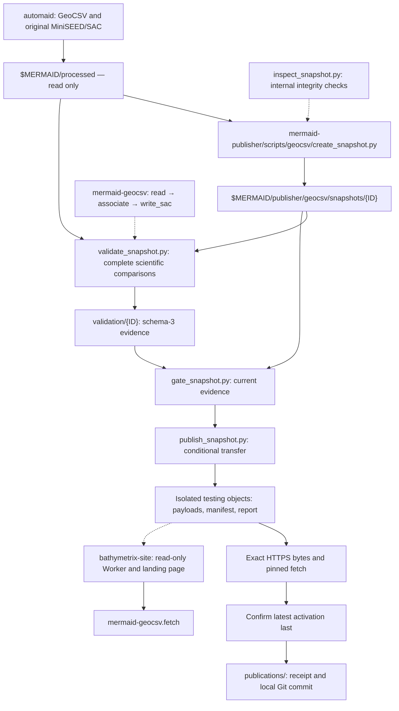

# GeoCSV hosting responsibilities and status

`mermaid-geocsv` owns public fetch/read/associate/write_sac APIs and their
scientific behavior. `mermaid-publisher` owns snapshot creation, full-archive
scientific validation, the report schema and publication gate, transfer, latest
activation and local archive recording. `bathymetrix-site` owns its read-only
R2 Worker, landing page, DNS/TLS and hosting runbook. Automaid generates source
GeoCSV and original waveforms. No publication scripts or report implementation
are part of this package.

The canonical [publication/download contract](../../mermaid-publisher/docs/geocsv/CONTRACT.md),
[publisher workflow](../../mermaid-publisher/docs/geocsv/WORKFLOW.md),
[scientific validation rules](../../mermaid-publisher/docs/geocsv/VALIDATION.md),
and [historical archive findings](../../mermaid-publisher/docs/geocsv/ARCHIVE_FINDINGS.md)
are maintained by the publisher. The [website runbook](../../bathymetrix-site/docs/GEOCSV_HOSTING.md)
records deployment and infrastructure status. Keep a single canonical contract;
package and host implementations must preserve supported consumer compatibility.
A publisher change does not implicitly authorize a corresponding fetch change.

## Current phase: testing only

All hosted data remain testing only, including complete-corpus tests. Publisher
0.1.0 requires `testing_only: true`, explicit testing destinations and complete
schema-3 scientific evidence. The local website Worker isolates
`/geocsv/testing/` and `geocsv/testing/` keys from future production activation.
Neither the Worker nor R2 data service is deployed. Production promotion, first
release tags and availability claims remain separately unauthorized.

The external archive is `$MERMAID/publisher`, a separate local Git repository;
GeoCSV uses `geocsv/{snapshots,staging,validation,publications}`. Published products
and evidence are retained indefinitely. Original waveform archives are not
copied. Git-tracked source inputs require a clean tree and full commit hash in
immutable local snapshot provenance; ordinary source directories remain valid.
Successful publication includes a scoped local archive commit, never an automatic
push. Source-provenance and receipt changes do not alter the fetch manifest.

The pre-migration schema-2 run passed 43,365 original waveform pairs, staging 103
GeoCSV files and recording nine recordless exclusions. Those findings remain
historical; new code/candidates require fresh validation. Scientific comparisons
retain the existing documented rules, including exact native float32 interval
preservation and a one-ULP allowance against independent SAC intervals. No
comparison tolerance is changed by migration.

## Release path contract

The complete agreement is maintained in the publisher contract linked above.
The existing fetch contract is unchanged: preserve the literal UTC `#created`
timestamp as `release_id`; URL and downloaded directory components percent-encode
colons, while server object keys contain literal colons. For example:

| Context | Example |
| --- | --- |
| Literal identity | `2026-10-21T22:48:33.277Z` |
| URL/local component | `2026-10-21T22%3A48%3A33.277Z` |

Fetch accepts an explicit `base_url`, resolves latest once or bypasses it for an
explicit release, validates manifest identity/testing flags, and checks sizes and
SHA-256 of exact uncompressed bytes. Relative paths remain `latest.json` and
`releases/{encoded ID}/manifest.json` with payloads alongside the manifest.
The independent publisher pins consumer baseline 0.24.0 at package commit
`c1eb805e420f7f8d4bfb8c6f737316c9f5766534` and retains fixed historical fixtures.
Changes to manifests, identities, paths or checksum semantics require explicit
compatibility review, separate from publisher/report version changes.

## Cross-repository workflow

## Implementation and remaining checks

- [x] Separate publisher tools/tests/contracts from package APIs and website hosting.
- [x] Rename internal modules to inspect_snapshot and gate_snapshot.
- [x] Implement local testing-only creation, transfer isolation and serving support.
- [x] Implement clean-source Git provenance, dedicated Git archives and publication receipts.
- [x] Preserve download semantics and freeze an independently installed consumer baseline.
- [ ] Run fresh complete-corpus schema-3 validation for a newly staged candidate.
- [ ] Set licensing/citation before uploads.
- [ ] Deploy approved R2/Worker configuration and verify SDK and live exact bytes.
- [ ] Verify pinned/latest, one/all instruments, disk/memory and scientific use.
- [ ] Restore DNSSEC after hosting verification.

As recorded on 2026-10-22, Cloudflare authority, proxy/TLS, email and scoped
Python-client edge access passed. DNSSEC remains disabled. Current hosting status
and recovery procedures belong in the website runbook. The sampled full-history
fixture checker remains package development tooling, not the publication gate.
