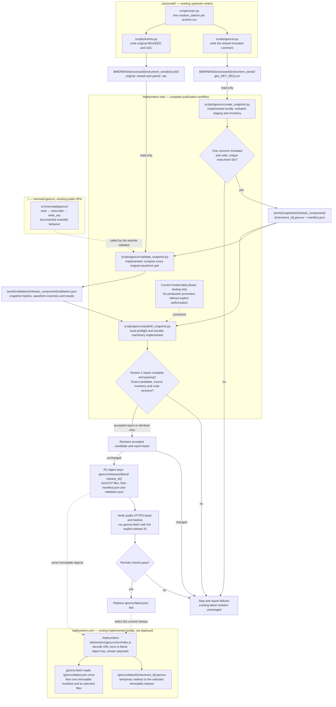

# GeoCSV hosting workflow and build checklist

This plan describes the GeoCSV hosting architecture as of 2026-10-22. The data
service is not operational. The planned public collection base is
`https://bathymetrix.com/geocsv/`, backed by Cloudflare R2 and a Worker route for
`/geocsv/*`. Production payloads will reside in object storage outside Git. The
existing website remains on GitHub Pages and domain registration at Squarespace.

`bathymetrix-site` owns snapshot creation, full-archive validation, the
acceptance-report format and gate, publication and hosting. Snapshot staging,
the timestamp manifest contract, Worker and publisher transfer machinery are
implemented locally in that repository, together with the full-archive validator,
version 2 report protocol and acceptance gate. Production publication requires
a complete passing archive report bound to the frozen candidate and current
inputs/code.
Cloudflare authoritative DNS onboarding is complete; the GeoCSV download
service is not deployed. `geocsv.fetch` supports the
timestamp release/path contract below as of package version 0.24.0. Nothing in
this document authorizes modification of protected processed inputs,
publication, or a package release.

The [website implementation and deployment runbook](../../bathymetrix-site/docs/GEOCSV_HOSTING.md)
and [publication contract](../../bathymetrix-site/docs/GEOCSV_CONTRACT.md)
record the website's local implementation, concrete report schema and archive
results. Validation and publication are both website-owned.

## Current publication phase: testing only

All hosted data remain explicitly testing only, including full-corpus transfer
and validation tests. Manifests/latest pointers must agree on `testing_only: true`,
and public descriptions must identify testing status. Timestamped snapshots do
not constitute a first scientific release. Production promotion, release tags
and production-availability claims require explicit authorization.

The website's current tools write or require `testing_only: false`. Testing-only
labeling and object/pointer isolation remain implementation prerequisites for
uploads. Scientific and licensing/citation gates remain in force; frozen
candidates/reports must not be relabeled. The website publication contract records
the full policy.

## Current website and DNS

Cloudflare authoritative DNS onboarding and website proxy activation are
complete as of 2026-10-22. All imported records were compared with Squarespace
and confirmed to match. Full (strict) is configured and only apex/www website
records are proxied; email and other service records remain unchanged. DNSSEC is
disabled. Squarespace remains registrar and GitHub Pages remains origin.

Public checks confirmed Cloudflare authority through two recursive resolvers.
After proxy activation, apex/www HTTPS validated through Cloudflare, HTTP and
`www` redirected to apex HTTPS without loops, and all four main pages returned
200 with Cloudflare edge responses. The Universal edge certificate is Active and
covers apex/www. Fresh post-proxy email sending and receiving both passed.

Browser Integrity Check initially blocked normal Python requests under
`/geocsv/`. The scoped configuration rule is now deployed: BIC is disabled only
for GET/HEAD on apex/www under `/geocsv/`, retaining the existing policy elsewhere.
On 2026-10-22, ordinary urllib GET/HEAD returned 200 for the landing page and the
expected 404 for the unpublished latest manifest on both hostnames. The unmodified
fetch client also reached the expected manifest 404 rather than a security 403.
Complete download and publisher HTTP verification remain pending until an
illustrative release is hosted under the same base after R2/Worker preparation.
Package HTTP behavior remains unchanged. Keep actual rule/account configuration
outside the repository. See the website runbook and
[Cloudflare selective BIC configuration](https://developers.cloudflare.com/waf/tools/browser-integrity-check/).

The next coordinated steps are to prepare private R2 storage and Worker
hosting, verify complete downloads and publication transport, and restore DNSSEC.
Production data activation still requires current scientific acceptance and
explicit authorization.

The chosen same-host `/geocsv/*` Worker route requires a proxied DNS record for
the hostname; a DNS CNAME cannot route a URL subpath. Actual operational
inventories, exports, account context and deployment configuration stay outside
repositories; tracked procedures use placeholders. Infrastructure changes require
explicit coordination.
See Cloudflare's [Worker routing requirements](https://developers.cloudflare.com/workers/best-practices/workers-best-practices/#set-up-custom-domains-or-routes-correctly)
and [primary DNS setup](https://developers.cloudflare.com/dns/zone-setups/full-setup/setup/).

## Recordless sources and validation scope

Data-recordless GeoCSV sources are never staged or published. The website keeps
a deterministic local-only staging inventory with explicit exclusions/reasons
and checks for hidden unexamined waveform inputs. That sidecar is not uploaded.
The report binds its hash separately from the published manifest. `.mhpsd`
spectra are outside the original MiniSEED/SAC validation scope and are not counted.

## Release identity and unchanged historical data

The exact value of the GeoCSV `#created` comment is the release ID. It identifies
the upstream automaid run, not observation coverage or the later publication
time. Require exactly one valid UTC `#created` declaration per file and the
same declaration value across every GeoCSV in the snapshot. Missing, repeated,
or inconsistent values raise; do not silently infer or repair them. Preserve
fractional digits. Record validation/publication times separately.

A dead float may produce identical historical data records indefinitely.
Those records do not have to change between releases. Updated comments,
including a new shared `#created`, are valid under a new release ID, even when
all non-comment records are unchanged. The publisher copies the complete
upstream file verbatim and hashes all bytes, including comments. There is no
requirement for a changed data row, and no deduplication across releases.

Published files and manifests remain immutable under an existing release ID.
An identical retry reuses the existing release; different bytes or a different
inventory under that same ID raise, including comment-only changes. Corrections
therefore need a new upstream run timestamp. Do not regenerate or overwrite an
existing release manifest simply to change its publication metadata.

## Release path contract

Keep the literal timestamp as `release_id` in JSON, fetch arguments and returned
provenance. Production timestamps use `YYYY-MM-DDTHH:MM:SS[.digits]Z`, with a
valid calendar date, hours 00–23 and seconds 00–59. Preserve every fractional
digit; do not parse and reformat the identity. The client also retains support
for plain ASCII token IDs such as `test-001` for illustrative test collections.
It verifies the manifest protocol, sizes and hashes, without interpreting each
GeoCSV's `#created`; snapshot-wide timestamp validation belongs to the publisher.

Define `release_component = urllib.parse.quote(release_id, safe="")`. In the
accepted timestamp grammar this changes only `:` to uppercase `%3A`. A client
must receive the literal ID, not an already encoded value. This representation
is lossless: decoding once recovers the identical ID, including fractional
digits. Equivalent instants with different fractional spellings are different
IDs; the publisher must require exact source spelling agreement.

For `release_id = "2026-10-21T22:48:33.277Z"`:

| Context | Representation |
| --- | --- |
| JSON `release_id`, fetch `release`, returned provenance | `2026-10-21T22:48:33.277Z` |
| URL component and downloaded local directory name | `2026-10-21T22%3A48%3A33.277Z` |
| Object key or server-side release directory | `2026-10-21T22:48:33.277Z` |

URLs contain the encoded component; storage keys contain the literal ID. Decode
the URL path **exactly once** when resolving the object key. Do not store `%3A`
in object keys or encode `%` again as `%25`. Local download directories retain
the encoded spelling so they contain no Windows-invalid colons. The publisher's
external staging/report workspace uses that same encoded directory spelling.
The storage provider may change without changing this public contract.

The latest pointer must use the exact encoded relative manifest path. The
current testing-only phase requires `testing_only: true` in both pointer and
manifest; the format below is relative to the isolated testing collection:

```json
{
  "release_id": "2026-10-21T22:48:33.277Z",
  "testing_only": true,
  "manifest": "releases/2026-10-21T22%3A48%3A33.277Z/manifest.json"
}
```

The immutable manifest contains the same literal `release_id`, boolean
`testing_only`, and a `files` array. Each entry requires a unique nonempty
`instrument_id`, unique `filename`, nonnegative integer `size_bytes`, lowercase
64-hex-digit `sha256`, and a `provenance` object. For production, each filename is
`{instrument_id}.geocsv`. Filenames start with an ASCII letter or digit and use
only ASCII letters, digits, `.`, `_`, and `-`; `manifest.json` is reserved.
Checksums and sizes describe complete uncompressed GeoCSV bytes. Descriptive
fields are retained verbatim without becoming filesystem instructions. No new
`release_component` JSON field is needed; it is derived from `release_id`.

The client pins latest once or bypasses it for an explicit ID, requires exact
manifest identity and test-flag agreement, and never falls back to another
release. These rules apply to any chosen host.

## Workflow diagram

The diagram retains the reviewed publication sequence; production object keys
are a future reference. Testing-mode labeling and isolation must be implemented
before uploads. Repository paths are relative to the `mermaid-geocsv/` root.
A subgraph names its repository root; paths inside it are relative to that root. `$MERMAID`
identifies the external read-only data tree. `{work}` is a chosen local
publication workspace outside all Git checkouts and the protected source tree;
it contains staged payloads, reports and temporary comparison outputs.



An identical retry verifies and reuses an existing immutable release; the
publisher must not overwrite its objects. A failed full-archive report blocks
publication. Upload failures or failed public checks block activation. The
previous latest release remains usable throughout these operations.

The Worker streams R2 payloads, serves `latest.json`, and redirects convenient
`/latest/` file URLs. The fetch client downloads through the immutable release
paths so a latest update cannot mix snapshots within one operation. HTTPS,
pointer cache bypass and immutable-object caching are hosting responsibilities.

## Ownership and scientific acceptance

| Owner | Script or responsibility | Status |
| --- | --- | --- |
| `../automaid/` | `scripts/main.py`, `scripts/geocsv.py`, `scripts/events.py`: create scientific outputs and their run timestamp | Existing |
| `../bathymetrix-site/` | `scripts/geocsv/create_snapshot.py`, private `snapshot.py`: stage verbatim bytes, validate the explicit serial-to-ID inventory, enforce one timestamp and freeze the manifest | Implemented locally |
| `../bathymetrix-site/` | `scripts/geocsv/validate_snapshot.py`: validate every original MiniSEED/SAC pair and produce the concrete acceptance report | Implemented locally; full archive results recorded in website documentation |
| `../bathymetrix-site/` | `scripts/geocsv/publish_snapshot.py`: preflight, upload, verify and activate | Implemented locally with versioned scientific acceptance and exact input rechecks |
| `../bathymetrix-site/` | `scripts/geocsv/acceptance.py`: version 2 report format and `require_scientific_acceptance` | Implemented locally alongside the validator |
| `../bathymetrix-site/` | `workers/geocsv/src/index.js`, `geocsv/index.html`: public routing, streaming, latest redirects and landing page | Implemented locally; not deployed |
| `./` | Public `read`, `associate`, `write_sac`, `fetch` APIs and documented scientific behavior | Implemented; no publication-validator script or report schema planned here |

The website's validator orchestrates the public package APIs and independent
reference comparisons. It does not implement another parser, matcher or SAC
projection. Keep workflow-specific validation, report generation and publisher
acceptance together in the website. Fix package defects in this repository;
coordinate unresolved scientific comparison rules before changing them.

The validator runs against the frozen candidate, not a separate live GeoCSV
copy. It inventories every original MiniSEED and paired SAC for all included
instruments; missing pairs, unsupported products and unexamined files are
reported rather than silently skipped. Process one instrument at a time with
bounded waveform batches and temporary SAC exports. Read/copy the protected
source only; never rewrite it or borrow SAC headers for association.

Associate originals with the standard strict contract and its documented
tolerances, without the containing-anchor fallback. Multiple waveform files
may use the same source row. Compare every paired file using the approved
SNCL, sample-count, sample-value, timing, interval and STLA/STLO/STDP/STEL rules.
Preserve raw counts subject to SAC float32 storage. Geographic comparisons
must account for documented source decimal precision and SAC float32 rounding;
an unexpected mismatch is reported, not grounds for automatic tolerance
widening. This covers every pair, not every producer-specific SAC header.

Website report version 2 retains exact native-to-export float32 interval
preservation and permits at most one float32 ULP against the independent SAC
interval. This mirrors the representation-check pattern in
`tests/test_earthscope_response.py`; it does not change association matching
thresholds or sample-value equality. Two-step reference differences fail.
Website coding instructions require consulting the relevant current package
contract and verification tests rather than inventing stricter or wider rules.

The machine-readable report records the release ID, exact candidate manifest
SHA-256, all staged file hashes, the source waveform inventory/fingerprints,
package/code/dependency versions, checks and limits, counts, measured maxima,
and individual failures. Missing coverage or any failed check blocks acceptance.
The publisher rechecks the complete candidate inventory and hashes before
uploading. A pass from different input bytes cannot authorize publication.

`validation.json` may accompany the immutable release as evidence outside the
manifest's GeoCSV `files` list. It binds the already-frozen manifest; avoid a
circular hash dependency by keeping its own hash out of that manifest.
Use source-relative identifiers in public reports, retaining local diagnostics
in the publication workspace.

The existing [full-history fixture checker](../scripts/fixtures/check_full_histories.py)
checks 18 sampled waveform associations. It does not perform full-archive
validation and cannot satisfy the publication gate by itself.

The website implements the documented 0.24.0 fetch contract. The validator,
versioned report format, acceptance adapter and complete archive run are
website-owned. The publisher requires the validator's complete evidence without
an acceptance bypass. Scientific failures block publication. Validation requires
Python 3.11 or newer and this package with the ObsPy extra. Staging's
standard-library-only environment can remain separate.
Real HTTPS integration checks follow once a host is available. Keeping
`base_url` explicit is supported; choosing a production default is optional
and does not block the website.

## Implementation checklist

These boxes distinguish verified local implementation and scientific acceptance
from pending deployed verification. On 2026-10-22, website report version 2 passed
all 43,365 original MiniSEED/SAC pairs and the publisher's acceptance gate
rechecked and accepted that evidence. All 32 website Python tests and nine Worker
tests passed. The website runbook and archive findings record the full outcome.
GeoCSV hosting and production publication remain inactive.

### 1. Coordinate the contract

- [x] Record the current testing-only phase for all hosted data, including
  complete-corpus tests; keep production promotion and first release unauthorized.
- [ ] **Website:** implement and verify testing-only flags, object/pointer isolation
  and public labeling before hosted uploads, preserving all scientific gates.
- [x] **This repository:** specify and test literal timestamp identity, encoded
  URLs/local directories, and literal server/object keys, including fractional
  digits and rejection of invalid or already encoded IDs (0.24.0).
- [x] **Website:** adopt timestamp identity, encoded URLs, literal object keys,
  exact-byte manifest fields and relative source provenance in local code/tests.
- [x] **Website:** document production paths and the publication/download
  protocol in `docs/GEOCSV_CONTRACT.md`.
- [x] **Website:** update the runbook, contract and diagram to place archive
  validation, its report format and acceptance gate in `scripts/geocsv/`.
- [x] **Website:** require an explicit serial-to-ID inventory, validate Station
  values, and reject unexpectedly missing previously published instruments.
- [ ] **Website:** settle the collection's data-license and citation text.

### 2. Stage a reproducible candidate

- [x] **Website:** implement `scripts/geocsv/create_snapshot.py` with an explicit
  source root and external publication workspace; run after processing finishes.
- [x] Enforce exactly one valid `#created` per file and exact snapshot-wide
  agreement; raise on missing/repeated/mixed timestamps or ambiguous IDs.
- [x] Copy each nonempty `geo_DET_REQ.csv` verbatim as `{instrument_id}.geocsv`,
  freeze the sorted complete manifest, and record full-file hashes and byte counts.
  Account for recordless source files in a local-only exclusion sidecar; never
  stage or publish them. The first candidate includes 103 files and excludes nine.
- [x] Cover identical historical rows and updated comments
  under a new shared timestamp passes; no new data row is required.
- [x] Cover differing bytes under an existing release ID raising, while an
  identical retry preserves the existing manifest and objects.

### 3. Establish full-archive scientific acceptance

- [x] **Website:** implement `scripts/geocsv/validate_snapshot.py` using this
  package's public APIs, complete waveform inventories and independent paired
  SAC reads. Keep this alongside creation and publication scripts.
- [x] **Website:** define the concrete versioned report format and implement
  `publish_snapshot.py`'s `require_scientific_acceptance` against it. Bind the
  exact candidate manifest and full file inventory with complete waveform
  accounting and explicit pass criteria; no arbitrary success flag suffices.
- [x] Fix comparison fields, units, missing-value rules and precision limits
  using the documented scientific contract; avoid whole-SAC equivalence claims.
- [x] Implement the candidate-bound validation report, complete accounting and
  useful failure diagnostics; leave sources unchanged and remove scratch SAC.
- [x] Exercise the gate with synthetic original waveforms and intentional missing-pair,
  association, sample and coordinate mismatches; failures must block publishing.
- [x] Run the complete local archive: all 43,365 original waveform pairs passed
  report version 2 and publication acceptance, with no failed, missing, unsupported
  or unexamined pairs. Maximum independent-reference interval distance was one
  float32 ULP; native interval error was zero. Spectra were outside scope and
  were not counted. Future candidates require their own accepted report.

### 4. Prepare hosting and safe publication

- [x] **Website:** prepare the DNS migration runbook, Worker deployment example
  and landing page without changing live infrastructure.
- [x] Complete Cloudflare authoritative DNS onboarding and compare all imported
  records with Squarespace; retain Squarespace registration and GitHub Pages.
- [x] Verify public Cloudflare authority and apex/www HTTPS and redirects.
- [x] Confirm an Active Universal edge certificate covering apex/www.
- [x] Configure Full (strict), proxy only website records, and verify public
  edge HTTPS, redirects and main-page responses.
- [x] Verify fresh email sending and receiving after proxy activation.
- [x] Identify Browser Integrity Check as the feature blocking default Python
  requests through Cloudflare Security Events.
- [x] Deploy the scoped download-path BIC exception; verify ordinary urllib
  GET/HEAD and unmodified fetch access to the expected unpublished manifest 404.
- [ ] Verify full unmodified fetch downloads and publisher HTTP checks against
  hosted test objects after R2/Worker deployment.
- [ ] Restore and verify DNSSEC after hosting verification; it is currently disabled.
- [ ] **Website:** configure R2 and Cloudflare routing/TLS for
  `bathymetrix.com/geocsv/`, including the landing page at `/geocsv/`.
- [x] Implement `workers/geocsv/src/index.js` for streamed immutable downloads,
  manifest/pointer delivery, correct missing-file responses and temporary latest
  redirects. Keep the main website's other routes working.
- [x] Implement no-store latest responses/redirects, deliberate immutable
  response caching and uncached misses/errors in the local Worker.
- [ ] Verify deployed cache configuration prevents stale latest and publication
  404s; local cache doubles do not establish production behavior.
- [ ] Serve plain GeoCSV with appropriate content metadata; honor
  `Accept-Encoding: identity` and verify the exact delivered bytes.
- [x] Implement publisher preflight and transfer sequencing with candidate
  rechecks, conditional immutable uploads, verification, serialization and
  conditional latest replacement last. Each candidate requires its own passing
  scientific acceptance report.
- [x] Cover interrupted uploads, changed candidates/reports, conflicting release
  bytes and competing activation using offline transport tests.
- [x] Connect the versioned scientific report gate with source/candidate rechecks.
- [ ] Validate optional SDK/deployment behavior and verify rollback to a retained
  release through the same acceptance rules.

### 5. Complete client integration and launch checks

- [x] **This repository:** implement timestamp-ID/path handling in `fetch`, with
  focused tests, version 0.24.0 and synchronized fetch tutorials.
- [x] **Website:** add localhost integration tests using the actual fetch client
  against generated snapshots; deployed HTTPS remains a separate check.
- [ ] Verify explicit release pinning and default latest selection against the
  real HTTPS endpoint, including one/all instruments and disk/memory downloads.
- [ ] Verify checksums, manifests and provenance survive `fetch → read`, and a
  public real-data example completes `associate → write_sac` as documented.
- [ ] Run both supported Python/dependency-bound CI jobs and their wheel checks
  after client changes; retain offline tests independent of hosting.
- [ ] Update package/website installation and download examples, decide whether
  to make the production base URL the fetch default, and link the release's
  manifest and acceptance report from the website.
- [ ] Mark components implemented only after verification, update this diagram
  and checklist, and record the actual first publication separately from any
  software v1 release. Neither publication is implicit authorization for the other.

## Keeping the plan current

Read the relevant instructions and current source in all three repositories
before implementation or revision. Changes to automaid timestamp generation,
output names, formatting or waveform processing can affect snapshot validation.
Changes to website staging, routes, manifests or publishing can affect fetch.
Update the diagram, paths, script names, status and checklist together as those
implementations evolve; coordinate contract changes across owners. Do not copy
scientific matching logic into the website or silently change numerical limits.

Read-only references inspected for this plan on 2026-10-22:

- `../automaid/` at `e841a1a0e2607582f10631c4f5989286d42d346b`:
  `scripts/main.py` creates one run timestamp and passes it to the GeoCSV writer;
  `scripts/geocsv.py` emits it as `#created`.
- `../bathymetrix-site/` at `f861d6182e3632e32bfc142294e24118b977830e`:
  plus uncommitted local changes inspected on 2026-10-22: the production
  contract, `docs/GEOCSV_HOSTING.md`, snapshot creator/private helpers, publisher
  preflight/transfer machinery, Worker, landing page and offline tests exist.
  The website now implements `scripts/geocsv/validate_snapshot.py` and
  `acceptance.py`, including versioned evidence, source rechecks and focused
  scientific rejection tests. Archive failures and launch readiness are
  tracked separately from local implementation.

These references are dated evidence, not permission to change those checkouts.
