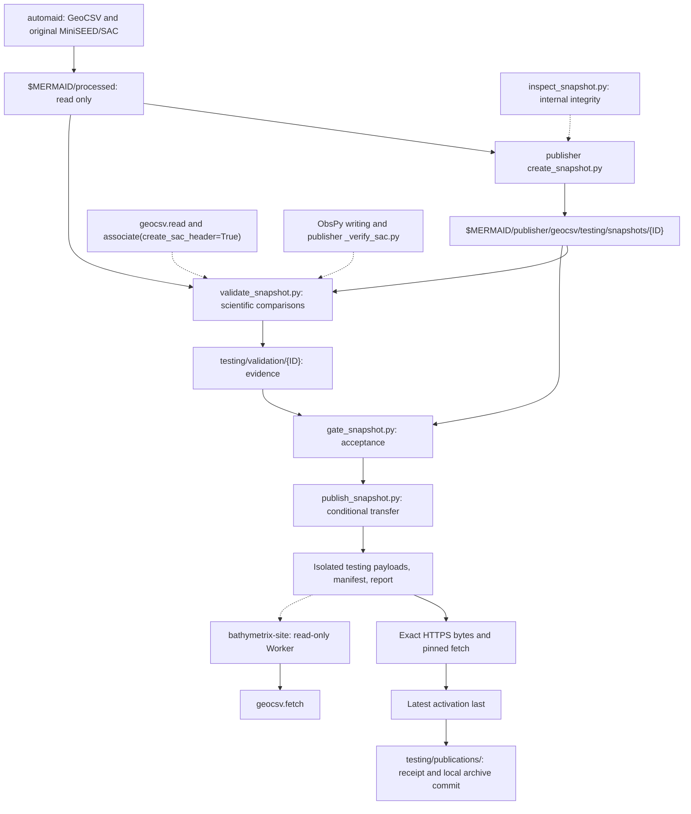

# GeoCSV hosting responsibilities

`mermaid-geocsv` owns fetch, read, associate, and optional SAC header creation.
Automaid produces GeoCSV and original waveforms. `mermaid-publisher` owns
snapshot creation, full-archive scientific validation, evidence and acceptance
gates, transfer, latest activation, and local archive recording.
`bathymetrix-site` owns the read-only Worker, landing page, and infrastructure.
Publication implementations and report schemas do not belong in this package.

The publisher maintains the canonical [publication/download contract](../../mermaid-publisher/docs/geocsv/CONTRACT.md),
[workflow](../../mermaid-publisher/docs/geocsv/WORKFLOW.md),
[scientific validation](../../mermaid-publisher/docs/geocsv/VALIDATION.md), and
[SAC export verification](../../mermaid-publisher/docs/geocsv/SAC_VERIFICATION.md).
The website [hosting runbook](../../bathymetrix-site/docs/GEOCSV_HOSTING.md)
owns deployment status and recovery procedures. These links refer to sibling
checkouts; the package's [fetch reference](FETCH.md) documents consumer behavior.
Publisher changes do not implicitly redefine the supported consumer baseline
or fetch contract. Published reports remain bound to their original bytes
and software evidence.

## Current phase: testing only

The recorded hosted testing collection is
`https://bathymetrix.com/geocsv/testing/`. Its P0006/P0045 snapshot
`2026-10-21T22:48:33.277Z` was published on 2026-10-26. Testing latest selects
that snapshot in the recorded publication evidence; production latest was
absent. These are recorded deployment observations, not a fresh live check.
Current receipts and scientific results belong in the
[publisher findings](../../mermaid-publisher/docs/geocsv/SCHEMA3_FINDINGS.md).

All hosted data remain testing only, including full-corpus tests. Keep
`testing_only: true`, isolated testing paths and pointers, and public testing
labels. Verify deployed publisher/website isolation before further uploads;
local implementation alone does not establish deployed behavior. Successful
validation or testing publication does not authorize production promotion or
a first scientific/software release.

## Hyphenated release paths — 2026-10-28

Consumer 0.26.0 and publisher 0.3.0 replace only the creation timestamp's colons
with hyphens when deriving release components. URLs, R2 keys and new local
snapshot/staging/validation/download directories use
`2026-10-21T22-48-33.277Z`; the GeoCSV `#created`, manifest `release_id`, fetch
argument and download provenance retain `2026-10-21T22:48:33.277Z` exactly.
Fractional precision and all other timestamps are unchanged.

The P0006/P0045 testing collection is authorized for replacement. Its previous
encoded URLs may be retired. New downloads require consumer 0.26.0 or newer;
the fixed 0.24.0 baseline and original fixtures remain historical scientific
and download checks, not compatibility promises for this new path protocol.
The Worker and testing replacement were deployed and verified on 2026-10-28.
All 3,292 original pairs passed fresh acceptance; live exact-byte downloads,
latest/pinned fetch and disk/memory/reuse passed. The four old testing objects
were retired, and their encoded URLs return uncached 404. Local historical
evidence is retained. Replacement/deployment evidence is recorded in the publisher's
[path review](../../mermaid-publisher/docs/geocsv/RELEASE_PATH_REVIEW.md).
Production remains inactive. Local code alone does not establish deployment.

## Cross-repository workflow

The six publisher modules live under `scripts/geocsv/`; only create, validate,
and publish are runnable commands. The external archive is the separate
`$MERMAID/publisher` repository, with testing snapshots, staging, validation,
and publication receipts under `geocsv/testing/`. Sources remain read-only;
original waveform archives are not copied there. Retain immutable testing
bytes until separately authorized retirement; never reuse retired IDs for
different bytes. Production retention remains indefinite. Successful
publication includes a scoped local archive commit, never an automatic push.

## Readiness boundaries

- [x] Separate package APIs, publisher validation/publication, and website serving.
- [x] Implement isolated testing snapshots, receipts, and consumer compatibility checks.
- [x] Record full-corpus validation and the two-instrument hosted testing publication in the publisher.
- [ ] Authorize production promotion and a first formal release separately.

The package's [sampled-history checker](../scripts/fixtures/README.md) supports
fixture verification; it is not the publication gate.
