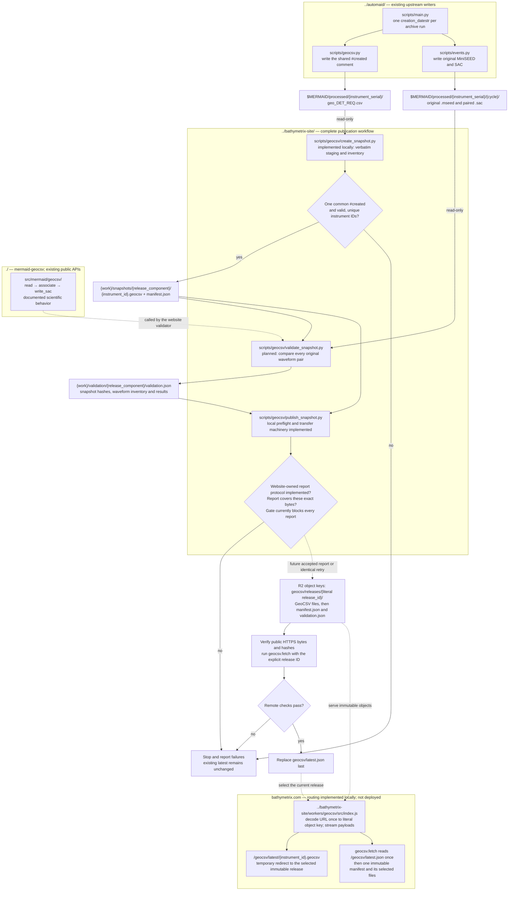

# GeoCSV hosting workflow and build checklist

Design agreed 2026-10-22. This is an implementation plan, not an operational
hosting service. The public collection base is planned as
`https://bathymetrix.com/geocsv/`. The main website remains independently
maintained; large GeoCSV payloads live in object storage rather than Git.
Cloudflare R2 and a Worker route for `/geocsv/*` were selected on 2026-10-22.
Keep the existing website on GitHub Pages and domain registration at Squarespace.

`bathymetrix-site` owns snapshot creation, full-archive validation, the
acceptance-report format and gate, publication and hosting. Snapshot staging,
the timestamp manifest contract, Worker and publisher transfer machinery are
implemented locally there. The full-archive validator and report protocol remain
to be implemented there; production publication is blocked until they pass.
No hosting infrastructure has been deployed. `geocsv.fetch` supports the
timestamp release/path contract below as of package version 0.24.0. Nothing in
this document authorizes modification of protected processed inputs,
publication, or a package release.

The [website implementation and deployment runbook](../../bathymetrix-site/docs/GEOCSV_HOSTING.md)
and [publication contract](../../bathymetrix-site/data/geocsv/testing/CONTRACT.md)
record the website's local implementation. Their existing package-owned
validator references need synchronization with the ownership defined here.

## Current website and DNS

The domain is registered with Squarespace. The website is hosted on GitHub
Pages, with a custom CNAME target of `bathymetrix.github.io`. The Squarespace
preset is inactive; custom DNS records provide the working configuration.
DNS is managed through Squarespace, with authoritative nameservers
`ns-cloud-c1.googledomains.com` through `ns-cloud-c4.googledomains.com`.
Configuration verified on 2026-10-22; recheck before deployment.

The chosen same-host `/geocsv/*` Worker route requires a Cloudflare zone and a
proxied DNS record for the hostname; a DNS CNAME cannot route a URL subpath.
Plan Cloudflare authoritative DNS onboarding while retaining Squarespace as
registrar and GitHub Pages as the website origin. Inventory and preserve the
working website and email records, and account for DNSSEC during that migration.
Prepare the complete migration/deployment steps before any live changes.
Selecting R2 does not itself activate a DNS migration or publish the data.
See Cloudflare's [Worker routing requirements](https://developers.cloudflare.com/workers/best-practices/workers-best-practices/#set-up-custom-domains-or-routes-correctly)
and [primary DNS setup](https://developers.cloudflare.com/dns/zone-setups/full-setup/setup/).

## Release identity and unchanged historical data

The exact value of the GeoCSV `#created` comment is the release ID. It identifies
the upstream automaid run, not observation coverage or the later publication
time. Require exactly one valid UTC `#created` declaration per file and the
same declaration value across every GeoCSV in the snapshot. Missing, repeated,
or inconsistent values raise; do not silently infer or repair them. Preserve
fractional digits. Record validation/publication times separately.

A dead float may produce identical historical data records indefinitely.
Those records do not have to change between releases. Updated comments,
including a new shared `#created`, are valid under a new release ID, even when
all non-comment records are unchanged. The publisher copies the complete
upstream file verbatim and hashes all bytes, including comments. There is no
requirement for a changed data row, and no deduplication across releases.

Published files and manifests remain immutable under an existing release ID.
An identical retry reuses the existing release; different bytes or a different
inventory under that same ID raise, including comment-only changes. Corrections
therefore need a new upstream run timestamp. Do not regenerate or overwrite an
existing release manifest simply to change its publication metadata.

## Release path contract

Keep the literal timestamp as `release_id` in JSON, fetch arguments and returned
provenance. Production timestamps use `YYYY-MM-DDTHH:MM:SS[.digits]Z`, with a
valid calendar date, hours 00–23 and seconds 00–59. Preserve every fractional
digit; do not parse and reformat the identity. The client also retains support
for plain ASCII token IDs such as `test-001` for illustrative test collections.
It verifies the manifest protocol, sizes and hashes, without interpreting each
GeoCSV's `#created`; snapshot-wide timestamp validation belongs to the publisher.

Define `release_component = urllib.parse.quote(release_id, safe="")`. In the
accepted timestamp grammar this changes only `:` to uppercase `%3A`. A client
must receive the literal ID, not an already encoded value. This representation
is lossless: decoding once recovers the identical ID, including fractional
digits. Equivalent instants with different fractional spellings are different
IDs; the publisher must require exact source spelling agreement.

For `release_id = "2026-10-21T22:48:33.277Z"`:

| Context | Representation |
| --- | --- |
| JSON `release_id`, fetch `release`, returned provenance | `2026-10-21T22:48:33.277Z` |
| URL component and downloaded local directory name | `2026-10-21T22%3A48%3A33.277Z` |
| Object key or server-side release directory | `2026-10-21T22:48:33.277Z` |

URLs contain the encoded component; storage keys contain the literal ID. Decode
the URL path **exactly once** when resolving the object key. Do not store `%3A`
in object keys or encode `%` again as `%25`. Local download directories retain
the encoded spelling so they contain no Windows-invalid colons. The publisher's
external staging/report workspace uses that same encoded directory spelling.
The storage provider may change without changing this public contract.

The latest pointer must use the exact encoded relative manifest path:

```json
{
  "release_id": "2026-10-21T22:48:33.277Z",
  "testing_only": false,
  "manifest": "releases/2026-10-21T22%3A48%3A33.277Z/manifest.json"
}
```

The immutable manifest contains the same literal `release_id`, boolean
`testing_only`, and a `files` array. Each entry requires a unique nonempty
`instrument_id`, unique `filename`, nonnegative integer `size_bytes`, lowercase
64-hex-digit `sha256`, and a `provenance` object. For production, each filename is
`{instrument_id}.geocsv`. Filenames start with an ASCII letter or digit and use
only ASCII letters, digits, `.`, `_`, and `-`; `manifest.json` is reserved.
Checksums and sizes describe complete uncompressed GeoCSV bytes. Descriptive
fields are retained verbatim without becoming filesystem instructions. No new
`release_component` JSON field is needed; it is derived from `release_id`.

The client pins latest once or bypasses it for an explicit ID, requires exact
manifest identity and test-flag agreement, and never falls back to another
release. These rules apply to any chosen host. The existing website test-token
collection remains compatible.

## Workflow diagram

Repository paths are relative to the `mermaid-geocsv/` root. A subgraph names
its repository root; paths inside it are relative to that root. `$MERMAID`
identifies the external read-only data tree. `{work}` is a chosen local
publication workspace outside all Git checkouts and the protected source tree;
it contains staged payloads, reports and temporary comparison outputs.



An identical retry verifies and reuses an existing immutable release; the
publisher must not overwrite its objects. A failed full-archive report blocks
publication. Upload failures or failed public checks block activation. The
previous latest release remains usable throughout these operations.

The Worker streams R2 payloads, serves `latest.json`, and redirects convenient
`/latest/` file URLs. The fetch client downloads through the immutable release
paths so a latest update cannot mix snapshots within one operation. HTTPS,
pointer cache bypass and immutable-object caching are hosting responsibilities.

## Ownership and scientific acceptance

| Owner | Script or responsibility | Status |
| --- | --- | --- |
| `../automaid/` | `scripts/main.py`, `scripts/geocsv.py`, `scripts/events.py`: create scientific outputs and their run timestamp | Existing |
| `../bathymetrix-site/` | `scripts/geocsv/create_snapshot.py`, private `snapshot.py`: stage verbatim bytes, validate the explicit serial-to-ID inventory, enforce one timestamp and freeze the manifest | Implemented locally |
| `../bathymetrix-site/` | `scripts/geocsv/validate_snapshot.py`: validate every original MiniSEED/SAC pair and produce the concrete acceptance report | Planned |
| `../bathymetrix-site/` | `scripts/geocsv/publish_snapshot.py`: preflight, upload, verify and activate | Local preflight/transfer machinery implemented; acceptance gate rejects every report |
| `../bathymetrix-site/` | Concrete versioned report format and `require_scientific_acceptance` | Planned; implement alongside the validator in the website repository |
| `../bathymetrix-site/` | `workers/geocsv/src/index.js`, `geocsv/index.html`: public routing, streaming, latest redirects and landing page | Implemented locally; not deployed |
| `./` | Public `read`, `associate`, `write_sac`, `fetch` APIs and documented scientific behavior | Implemented; no publication-validator script or report schema planned here |

The website's validator orchestrates the public package APIs and independent
reference comparisons. It does not implement another parser, matcher or SAC
projection. Keep workflow-specific validation, report generation and publisher
acceptance together in the website. Fix package defects in this repository;
coordinate unresolved scientific comparison rules before changing them.

The validator runs against the frozen candidate, not a separate live GeoCSV
copy. It inventories every original MiniSEED and paired SAC for all included
instruments; missing pairs, unsupported products and unexamined files are
reported rather than silently skipped. Process one instrument at a time with
bounded waveform batches and temporary SAC exports. Read/copy the protected
source only; never rewrite it or borrow SAC headers for association.

Associate originals with the standard strict contract and its documented
tolerances, without the containing-anchor fallback. Multiple waveform files
may use the same source row. Compare every paired file using the approved
SNCL, sample-count, sample-value, timing, interval and STLA/STLO/STDP/STEL rules.
Preserve raw counts subject to SAC float32 storage. Geographic comparisons
must account for documented source decimal precision and SAC float32 rounding;
an unexpected mismatch is reported, not grounds for automatic tolerance
widening. This covers every pair, not every producer-specific SAC header.

The machine-readable report records the release ID, exact candidate manifest
SHA-256, all staged file hashes, the source waveform inventory/fingerprints,
package/code/dependency versions, checks and limits, counts, measured maxima,
and individual failures. Missing coverage or any failed check blocks acceptance.
The publisher rechecks the complete candidate inventory and hashes before
uploading. A pass from different input bytes cannot authorize publication.

`validation.json` may accompany the immutable release as evidence outside the
manifest's GeoCSV `files` list. It binds the already-frozen manifest; avoid a
circular hash dependency by keeping its own hash out of that manifest.
Use source-relative identifiers in public reports, retaining local diagnostics
in the publication workspace.

The existing [full-history fixture checker](../scripts/fixtures/check_full_histories.py)
checks 18 sampled waveform associations. It is not the proposed complete-corpus
validator and cannot satisfy the publication gate by itself.

Website development can continue against the documented 0.24.0 fetch contract
without another client API change. The remaining validator, concrete report
format, acceptance adapter and complete archive run are all website-owned work;
there is no package-owned validator/report deliverable to wait for. The
publisher must consume its validator's report without a temporary acceptance
bypass. The validator needs Python 3.11 or newer and this package with the ObsPy
extra. Staging's standard-library-only environment can remain separate.
Real HTTPS integration checks follow once a host is available. Keeping
`base_url` explicit is supported; choosing a production default is optional
and does not block the website.

## Implementation checklist

These boxes distinguish reviewed local implementation from pending scientific
acceptance and deployed verification. Website source and offline tests were
inspected on 2026-10-22; website tests were not rerun for this documentation
update. No live infrastructure or production release is activated.

### 1. Coordinate the contract

- [x] **This repository:** specify and test literal timestamp identity, encoded
  URLs/local directories, and literal server/object keys, including fractional
  digits and rejection of invalid or already encoded IDs (0.24.0).
- [x] **Website:** adopt timestamp identity, encoded URLs, literal object keys,
  exact-byte manifest fields and relative source provenance in local code/tests.
- [x] **Website:** extend `data/geocsv/testing/CONTRACT.md` with production paths
  while retaining the unchanged illustrative test collection.
- [ ] **Website:** update the runbook, contract and diagram to place archive
  validation, its report format and acceptance gate in `scripts/geocsv/`.
- [x] **Website:** require an explicit serial-to-ID inventory, validate Station
  values, and reject unexpectedly missing previously published instruments.
- [ ] **Website:** settle the collection's data-license and citation text.

### 2. Stage a reproducible candidate

- [x] **Website:** implement `scripts/geocsv/create_snapshot.py` with an explicit
  source root and external publication workspace; run after processing finishes.
- [x] Enforce exactly one valid `#created` per file and exact snapshot-wide
  agreement; raise on missing/repeated/mixed timestamps or ambiguous IDs.
- [x] Copy each `geo_DET_REQ.csv` verbatim as `{instrument_id}.geocsv`, freeze
  the sorted complete manifest, and record full-file hashes and byte counts.
- [x] Cover identical historical rows and updated comments
  under a new shared timestamp passes; no new data row is required.
- [x] Cover differing bytes under an existing release ID raising, while an
  identical retry preserves the existing manifest and objects.

### 3. Establish full-archive scientific acceptance

- [ ] **Website:** implement `scripts/geocsv/validate_snapshot.py` using this
  package's public APIs, complete waveform inventories and independent paired
  SAC reads. Keep this alongside creation and publication scripts.
- [ ] **Website:** define the concrete versioned report format and implement
  `publish_snapshot.py`'s `require_scientific_acceptance` against it. Bind the
  exact candidate manifest and full file inventory with complete waveform
  accounting and explicit pass criteria; no arbitrary success flag suffices.
- [ ] Fix comparison fields, units, missing-value rules and precision limits
  using the documented scientific contract; avoid whole-SAC equivalence claims.
- [ ] Produce the candidate-bound validation report, complete accounting and
  useful failure diagnostics; leave sources unchanged and remove scratch SAC.
- [ ] Exercise the gate with real inputs and intentional missing-pair,
  association, sample and coordinate mismatches; failures must block publishing.
- [ ] Run the complete local archive and resolve every failure or unsupported
  input before accepting the first candidate. Record actual checked counts.

### 4. Prepare hosting and safe publication

- [x] **Website:** prepare the DNS migration runbook, Worker deployment example
  and landing page without changing live infrastructure.
- [ ] Confirm actual DNS/email records and DNSSEC state; preserve them through
  reviewed onboarding with Squarespace registration and GitHub Pages retained.
- [ ] **Website:** configure R2 and Cloudflare routing/TLS for
  `bathymetrix.com/geocsv/`, including the landing page at `/geocsv/`.
- [x] Implement `workers/geocsv/src/index.js` for streamed immutable downloads,
  manifest/pointer delivery, correct missing-file responses and temporary latest
  redirects. Keep the main website's other routes working.
- [x] Implement no-store latest responses/redirects, deliberate immutable
  response caching and uncached misses/errors in the local Worker.
- [ ] Verify deployed cache configuration prevents stale latest and publication
  404s; local cache doubles do not establish production behavior.
- [ ] Serve plain GeoCSV with appropriate content metadata; honor
  `Accept-Encoding: identity` and verify the exact delivered bytes.
- [x] Implement publisher preflight and transfer sequencing with candidate
  rechecks, conditional immutable uploads, verification, serialization and
  conditional latest replacement last; scientific acceptance remains blocked.
- [x] Cover interrupted uploads, changed candidates/reports, conflicting release
  bytes and competing activation using offline transport tests.
- [ ] Connect the real scientific gate, validate optional SDK/deployment behavior,
  and verify rollback to a retained release through the same acceptance rules.

### 5. Complete client integration and launch checks

- [x] **This repository:** implement timestamp-ID/path handling in `fetch`, with
  focused tests, version 0.24.0 and synchronized fetch tutorials.
- [x] **Website:** add localhost integration tests using the actual fetch client
  against generated snapshots; deployed HTTPS remains a separate check.
- [ ] Verify explicit release pinning and default latest selection against the
  real HTTPS endpoint, including one/all instruments and disk/memory downloads.
- [ ] Verify checksums, manifests and provenance survive `fetch → read`, and a
  public real-data example completes `associate → write_sac` as documented.
- [ ] Run both supported Python/dependency-bound CI jobs and their wheel checks
  after client changes; retain offline tests independent of hosting.
- [ ] Update package/website installation and download examples, decide whether
  to make the production base URL the fetch default, and link the release's
  manifest and acceptance report from the website.
- [ ] Mark components implemented only after verification, update this diagram
  and checklist, and record the actual first publication separately from any
  software v1 release. Neither publication is implicit authorization for the other.

## Keeping the plan current

Read the relevant instructions and current source in all three repositories
before implementation or revision. Changes to automaid timestamp generation,
output names, formatting or waveform processing can affect snapshot validation.
Changes to website staging, routes, manifests or publishing can affect fetch.
Update the diagram, paths, script names, status and checklist together as those
implementations evolve; coordinate contract changes across owners. Do not copy
scientific matching logic into the website or silently change numerical limits.

Read-only references inspected for this plan on 2026-10-22:

- `../automaid/` at `e841a1a0e2607582f10631c4f5989286d42d346b`:
  `scripts/main.py` creates one run timestamp and passes it to the GeoCSV writer;
  `scripts/geocsv.py` emits it as `#created`.
- `../bathymetrix-site/` at `f861d6182e3632e32bfc142294e24118b977830e`:
  plus uncommitted local changes inspected on 2026-10-22: the production
  contract, `docs/GEOCSV_HOSTING.md`, snapshot creator/private helpers, publisher
  preflight/transfer machinery, Worker, landing page and offline tests exist.
  Scientific acceptance still blocks every report; the validator does not yet
  exist. Website ownership references need the update specified above.

These references are dated evidence, not permission to change those checkouts.
